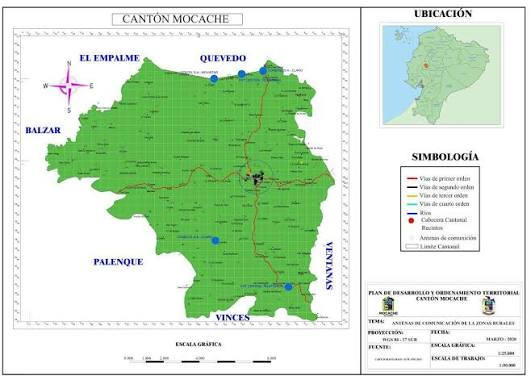
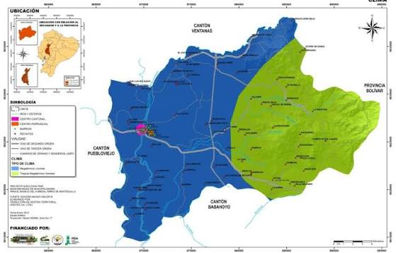
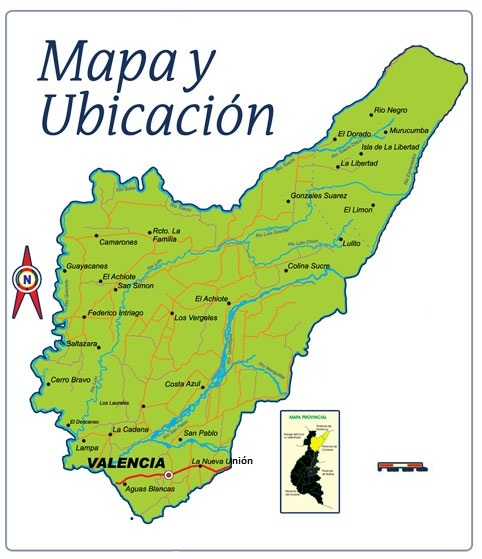
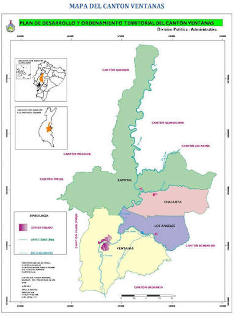

<html>
<title>
    DATOS DE LA PROVINCIA DE LOS RÍOS
</title>
<head>

</head>
<h1>Datos de la Provincia de Los Ríos</h1>

<a href="#Seccion_Descripcion">Ingresar a Descripcion de la provincia</a>
 
<a href="#Imagen de la Bandera">Ingresar a Imagen de la Bandera</a>
 
<a href="#Seccion_Prefecto">Ingresar a Prefecto</a>
 
<a href="#Gobernador">Ingresar a Gobernador</a>
 
<a href="#Población">Ingresar a Población</a>
 
<a href="#Mapa">Ingresar a Mapa</a>
 
<a href="#Fecha">Ingresar a Fecha</a>
 
<a href="#Caratula_Cantones">Ir a Sección: Menu: Cantones</a>

                

<h2 id="Seccion_Descripcion"><b>Descripcion de la provincia</b></h2>

Los Ríos es una de las provincias de la región litoral del Ecuador, caracterizada por su alta productividad agrícola, sus extensas cuencas hidrográficas y su variada cultura montubia.

<a href="#">Volver al Menú Principal</a>

<h2 id="Imagen de la Bandera"><b>Imagen de la Bandera</b></h2>

<a href="#">Volver al Menú Principal</a>

<h2 id="Seccion_Prefecto"><b>Prefecto</b></h2>

El prefecto actual es el Sr. Johnny Terán Salcedo.

<a href="#">Volver al Menú Principal</a>

<h2 id="Gobernador"><b>Gobernador</b></h2>

El gobernador de la provincia es el Sr. Luis Alfonso Chonillo.

<a href="#">Volver al Menú Principal</a>

<h2 id="Población"><b>Población</b></h2>

La provincia cuenta con un aproximado de 898,635 habitantes en todo su territorio.

<a href="#">Volver al Menú Principal</a>

<h2 id="Mapa"><b>Mapa</b></h2>

<a href="#">Volver al Menú Principal</a>

<h2 id="Fecha"><b>Fecha</b></h2>

Fecha de consulta del sitio web: 02 de Noviembre de 2026.

<a href="#">Volver al Menú Principal</a>

                

<h1 id="Caratula_Cantones">Menu: Cantones</h1>

<a href="#Cantón Baba">Ingresar a Baba</a>
 
<a href="#Cantón Babahoyo">Ingresar a Babahoyo</a>
 
<a href="#Cantón Buena Fe">Ingresar a Buena Fe</a>
 
<a href="#Cantón Mocache">Ingresar a Mocache</a>
 
<a href="#Cantón Montalvo">Ingresar a Montalvo</a>
 
<a href="#Cantón Palenque">Ingresar a Palenque</a>
 
<a href="#Cantón Puebloviejo">Ingresar a Puebloviejo</a>
 
<a href="#Cantón Quevedo">Ingresar a Quevedo</a>
 
<a href="#Cantón Quinsaloma">Ingresar a Quinsaloma</a>
 
<a href="#Cantón Urdaneta">Ingresar a Urdaneta</a>
 
<a href="#Cantón Valencia">Ingresar a Valencia</a>
 
<a href="#Cantón Ventanas">Ingresar a Ventanas</a>
 
<a href="#Cantón Vinces">Ingresar a Vinces</a>
 
<a href="#">Volver al Menú Principal de la Provincia</a>

                

<h2 id="Cantón Baba"><b>Cantón Baba</b></h2>

<b>Breve descripción reseña del canton:</b> Baba es uno de los cantones más antiguos de la provincia, apodado históricamente como "La Noble y Torera" por su valiente participación en las rebeliones criollas contra el yugo español.
  
<b>Indicar sus parroquias:</b> Está compuesto por la parroquia urbana de Baba y las parroquias rurales de Guare e Isla de Bejucal.
  
<b>Platos de comida típicos:</b> Los platos más tradicionales son los bollos de pescado, el seco de gallina criolla y la cazuela de pescado.
  
<b>Lugares turísticos y por que es turístico:</b> Es turístico por sus hermosas playas de agua dulce junto al Río Baba y sus balnearios recreativos ideales para la temporada playera.
  
<b>Hoteles donde alojarse:</b> Hostal Central Baba y Residencial La Nobleza ofrecen hospedaje cómodo en el sector céntrico.
  
<b>Alcalde:</b> La administración municipal está a cargo de la Ab. Jael Melo Olvera.
  
<b>Poblacion:</b> Su población estimada ronda los 43,000 habitantes.
  
<b>Mapa:</b> 

<a href="#Menú de Cantones">Volver al Menú de Cantones</a>

<h2 id="Cantón Babahoyo"><b>Cantón Babahoyo</b></h2>

<b>Breve descripción reseña del canton:</b> Babahoyo es la capital de la provincia de Los Ríos y fue fundada el 30 de septiembre de 1948. Es una ciudad de enorme trascendencia comercial, fluvial e histórica, conocida tradicionalmente por sus casas flotantes sobre el río y su fuerte nexo con la identidad montubia.
  
<b>Indicar sus parroquias:</b> Su territorio comprende las parroquias urbanas de Barreiro, El Salto, Camilo Ponce y Clemente Baquerizo; y las parroquias rurales de Caracol, Febres Cordero, La Unión y Pimocha.
  
<b>Platos de comida típicos:</b> Es famosa a nivel nacional por el ceviche de chocho, el cazabe, el estofado de pescado, el gallo pinto y el tradicional seco de gallina criolla.
  
<b>Luagres turísticos y por que es turístico:</b> Es un gran destino turístico por la Casa de Olmedo (donde el escritor redactó sus obras históricas), el paseo en lancha por el Río Babahoyo para observar las casas flotantes y el imponente Cerro Cacharí.
  
<b>Hoteles donde alojarse:</b> Ofrece hospedajes como el Hotel Emperador, Hotel Central y el Hotel El Ejecutivo en su casco central.
  
<b>Alcalde:</b> La administración municipal actual está a cargo del alcalde ciudadano.
  
<b>Poblacion:</b> Cuenta con una población estimada de más de 150,000 habitantes, siendo el centro urbano más denso de la provincia.
  
<b>Mapa:</b> 

<a href="#Caratula_Cantones">Volver al Menú de Cantones</a>

<h2 id="Cantón Buena Fe"><b>Cantón Buena Fe</b></h2>

<b>Breve descripción reseña del canton:</b> San Jacinto de Buena Fe es un cantón con un acelerado crecimiento comercial y agrícola, estratégico por conectar rutas de transporte nacionales primarias.
  
<b>Indicar sus parroquias:</b> Está constituido por la parroquia urbana de Buena Fe y la parroquia rural de Patricia Pilar.
  
<b>Platos de comida típicos:</b> Destacan los caldos de bola, el estofado de pescado y carnes asadas tradicionales en sus avenidas principales.
  
<b>Luagres turísticos y por que es turístico:</b> Es turístico debido al imponente paso del Río Baba, sus cascadas en recintos periféricos y la cercanía al proyecto hidromecánico Velasco Ibarra.
  
<b>Hoteles donde alojarse:</b> Los viajeros disponen del Hotel D'Mario y el Hostal Buena Fe para su alojamiento.
  
<b>Alcalde:</b> El cantón es administrado por la alcaldesa Ab. Diana Anchundia Yépez.
  
<b>Poblacion:</b> Posee una densidad de población calculada en más de 63,000 habitantes.
  
<b>Mapa:</b> 

<a href="#Caratula_Cantones">Volver al Menú de Cantones</a>

<h2 id="Cantón Mocache"><b>Cantón Mocache</b></h2>

<b>Breve descripción reseña del canton:</b> El cantón Mocache fue creado oficialmente el 28 de mayo de 1996. Es considerado una zona agrícola de altísima importancia en la provincia, destacando su producción de maíz, cacao y café, y poseyendo un arraigo muy profundo en las tradiciones del campo y la cultura montubia.
  
<b>Indicar sus parroquias:</b> El cantón está conformado por su cabecera cantonal mediante la parroquia urbana de Mocache, abarcando además una amplia cantidad de recintos y sectores comunitarios rurales.
  
<b>Platos de comida típicos:</b> En su mesa tradicional sobresale el seco de gallina criolla, los bollos de pescado, la tonga y los deliciosos platos preparados a base de pescado de río asado en hojas de plátano.
  
<b>Luagres turísticos y por que es turístico:</b> Es turístico debido a sus balnearios naturales de agua dulce sobre el Río Quevedo (que cruza la zona), sus reconocidas haciendas cacaoteras que fomentan el agroturismo y las tradicionales regatas fluviales y rodeos montubios que atraen a miles de visitantes.
  
<b>Hoteles donde alojarse:</b> Los turistas recurren habitualmente a hostales locales en el casco urbano o aprovechan las ofertas de hospedaje en la vecina ciudad de Quevedo debido a su extrema cercanía.
  
<b>Alcalde:</b> La administración municipal está liderada por la alcaldesa Ab. Yenny Domínguez.
  
<b>Poblacion:</b> Cuenta con una población estimada que ronda los 44,600 habitantes en todo su territorio.
  
<b>Mapa:</b> 

<a href="#Caratula_Cantones">Volver al Menú de Cantones</a>

<h2 id="Cantón Montalvo"><b>Cantón Montalvo</b></h2>

<b>Breve descripción reseña del canton:</b> Montalvo goza de una ubicación geográfica privilegiada en las faldas de la cordillera, dándole un microclima fresco diferente a la costa tradicional.
  
<b>Indicar sus parroquias:</b> Este cantón cuenta únicamente con su cabecera cantonal urbana (Montalvo), no poseyendo parroquias rurales delimitadas jurídicamente.
  
<b>Platos de comida típicos:</b> Es sumamente popular por su fritada montalvina, los tamales de maíz y los secos de pato criollo.
  
<b>Luagres turísticos y por que es turístico:</b> Es turístico gracias a sus ríos de agua cristalina y lechos de piedra, así como numerosos complejos recreacionales dotados de piscinas e infraestructura vacacional.
  
<b>Hoteles donde alojarse:</b> Cuenta con hosterías campestres de descanso completo como la Hostería San José.
  
<b>Alcalde:</b> El alcalde al frente de la municipalidad es el Sr. Eduardo Troncoso.
  
<b>Poblacion:</b> Su densidad poblacional total se calcula en 24,000 habitantes.
  
<b>Mapa:</b> 

<a href="#Caratula_Cantones">Volver al Menú de Cantones</a>

<h2 id="Cantón Palenque"><b>Cantón Palenque</b></h2>

<b>Breve descripción reseña del canton:</b> Palenque fue cantonizado oficialmente el 2 de agosto de 1990. Es una tierra históricamente conocida como la cuna del prócer de la independencia Nicolás Infante Díaz, y destaca a nivel nacional por su inmensa producción de maíz, cacao y por preservar la herencia cultural del montubio ecuatoriano.
  
<b>Indicar sus parroquias:</b> El territorio está constituido únicamente por su cabecera cantonal mediante la parroquia urbana de Palenque, complementándose de forma directa con sus recintos y comunidades del sector rural.
  
<b>Platos de comida típicos:</b> Su gastronomía típica se compone principalmente del tradicional seco de gallina criolla, el bollo de pescado, la cazuela y la tonga de gallina preparada de forma artesanal en el campo.
  
<b>Luagres turísticos y por que es turístico:</b> Es turístico debido a las hermosas playas fluviales que se forman en el Río Vinces (como la playa de La Reveza), la Reserva Ecológica Jauneche que atrae a investigadores y amantes de la naturaleza, y sus fiestas tradicionales del rodeo montubio.
  
<b>Hoteles donde alojarse:</b> Los viajeros se hospedan en pensiones familiares y hostales del casco central o recurren al hospedaje en los cantones cercanos de Vinces o Ventanas por su gran proximidad vial.
  
<b>Alcalde:</b> La administración municipal se encuentra bajo el liderazgo de las autoridades locales vigentes.
  
<b>Poblacion:</b> Cuenta con una población estimada que ronda los 25,000 habitantes en su territorio cantonal.
  
<b>Mapa:</b> 

<a href="#Caratula_Cantones">Volver al Menú de Cantones</a>

<h2 id="Cantón Puebloviejo"><b>Cantón Puebloviejo</b></h2>

<b>Breve descripción reseña del canton:</b> El cantón San Francisco de Puebloviejo fue fundado históricamente el 7 de febrero de 1846. Es conocido tradicionalmente como "El Corazón de Los Ríos" debido a su ubicación geográfica céntrica y destaca por ser uno de los principales productores y exportadores de banano y cacao de la provincia.
  
<b>Indicar sus parroquias:</b> Está constituido por su cabecera cantonal mediante la parroquia urbana de Puebloviejo, y por las parroquias rurales de San Juan y Puerto Pechiche.
  
<b>Platos de comida típicos:</b> Su mesa tradicional es famosa por el auténtico seco de gallina criolla, el seco de pato, los bollos de pescado y el tradicional sándwich de chancho.
  
<b>Luagres turísticos y por que es turístico:</b> Es turístico debido a sus pintorescas calles adornadas con tradicionales casas antiguas de madera, la Iglesia Central de San Francisco de Asís, diversos yacimientos arqueológicos en forma de tolas preincaicas, y sus festividades cívicas y religiosas.
  
<b>Hoteles donde alojarse:</b> Los visitantes recurren a hostales y pensiones de paso en el casco comercial central o aprovechan la infraestructura hotelera de los cantones colindantes de Babahoyo y Ventanas debido a la fluida conexión vial.
  
<b>Alcalde:</b> La administración municipal se encuentra bajo el liderazgo de la alcaldesa Elsy Ospina Garcés.
  
<b>Poblacion:</b> Cuenta con una población estimada que ronda los 46,800 habitantes en su territorio cantonal.
  
<b>Mapa:</b> 

<a href="#Caratula_Cantones">Volver al Menú de Cantones</a>

<h2 id="Cantón Quevedo"><b>Cantón Quevedo</b></h2>

<b>Breve descripción reseña del canton:</b> El cantón Quevedo fue creado oficialmente el 7 de octubre de 1943. Es conocido como la "Capital Económica de Los Ríos" y la "Ciudad del Río" debido a su gigantesco movimiento comercial, financiero e industrial, consolidándose como uno de los polos de desarrollo más dinámicos del país.
  
<b>Indicar sus parroquias:</b> Su territorio está integrado por nueve parroquias urbanas: Quevedo, San Camilo, San Cristóbal, Venus del Río Quevedo, Nicolas Infante Díaz, Guayacán, Siete de Octubre, 24 de Mayo y El Pantano; y dos parroquias rurales: San Carlos y La Esperanza.
  
<b>Platos de comida típicos:</b> Destaca por su gran variedad gastronómica donde sobresalen el tradicional estofado de pescado, los bollos, el gallo pinto y la popular fritada, complementándose con una fuerte influencia de comida chifa (asiática-ecuatoriana) debido a su historia migratoria.
  
<b>Luagres turísticos y por que es turístico:</b> Es un destino muy turístico por su icónico Puente Velasco Ibarra, el Malecón de la Ruta del Río (atractivo centro de entretenimiento y gastronomía fluvial), la Iglesia de San José y sus concurridas festividades comerciales y de cantonización.
  
<b>Hoteles donde alojarse:</b> Dispone de una excelente infraestructura hotelera que incluye al Hotel Barros, Hotel Palmar del Sol, Hotel Olímpico y el Ejecutivo, ofreciendo alta comodidad para el turismo de negocios.
  
<b>Alcalde:</b> La administración municipal está liderada por el alcalde Dr. Alexis Fernando Matute.
  
<b>Poblacion:</b> Cuenta con una población censada de 206,008 habitantes, siendo el cantón más poblado y con mayor densidad de la provincia.
  
<b>Mapa:</b> 

<a href="#Caratula_Cantones">Volver al Menú de Cantones</a>

<h2 id="Cantón Quinsaloma"><b>Cantón Quinsaloma</b></h2>

<b>Breve descripción reseña del canton:</b> Quinsaloma es el cantón más joven de la provincia de Los Ríos, creado oficialmente el 20 de noviembre de 2007. Su nombre proviene de la unión de "Quinsa" (tres en quichua) y "Loma", y es una zona eminentemente agrícola, famosa por sus extensas plantaciones de naranja, cacao, café y madera de exportación.
  
<b>Indicar sus parroquias:</b> El territorio está constituido únicamente por su cabecera cantonal mediante la parroquia urbana de Quinsaloma, complementándose directamente con una gran cantidad de recintos rurales productores.
  
<b>Platos de comida típicos:</b> Su gastronomía tradicional destaca por el seco de gallina criolla cooked a leña, los bollos de pescado, la tonga montubia y los deliciosos asados al carbón acompañados de verde.
  
<b>Luagres turísticos y por que es turístico:</b> Es un destino turístico emergente gracias a sus hermosos ríos de agua cristalina y balnearios naturales como el Río Umbe, el estero de Las Palmitas y diversos complejos ecoturísticos campestres que ofrecen un ambiente ideal para el descanso familiar.
  
<b>Hoteles donde alojarse:</b> Los visitantes se hospedan en pensiones familiares y hostales cómodos dentro del casco central, o aprovechan la cercanía con el cantón Ventanas y la provincia de Cotopaxi para opciones adicionales.
  
<b>Alcalde:</b> La administración municipal se encuentra bajo el liderazgo de las autoridades locales vigentes del cantón.
  
<b>Poblacion:</b> Cuenta con una población estimada que ronda los 16,500 habitantes en su territorio cantonal.
  
<b>Mapa:</b> 

<a href="#Caratula_Cantones">Volver al Menú de Cantones</a>

<h2 id="Cantón Urdaneta"><b>Cantón Urdaneta</b></h2>

<b>Breve descripción reseña del canton:</b> El cantón Urdaneta fue fundado oficialmente el 11 de octubre de 1913. Su nombre rinde homenaje al prócer Capitán Luis Urdaneta y es una zona históricamente rica y de gran productividad agrícola, destacando principalmente en la producción de cacao fino de aroma, café, arroz y banano.
  
<b>Indicar sus parroquias:</b> El territorio está constituido por su cabecera cantonal mediante la parroquia urbana de Catarama, y por la parroquia rural de Ricaurte.
  
<b>Platos de comida típicos:</b> En su mesa tradicional sobresale el auténtico seco de gallina criolla, los bollos de pescado, la cazuela y el sabroso arroz con menestra y carne asada.
  
<b>Luagres turísticos y por que es turístico:</b> Es turístico debido a sus balnearios naturales sobre el Río Catarama, sus hermosas fincas y haciendas cacaoteras que fomentan el agroturismo, y las tradicionales cabalgatas y rodeos montubios que se celebran anualmente reflejando la identidad local.
  
<b>Hoteles donde alojarse:</b> Los visitantes cuentan con pensiones y hostales locales en el casco urbano de Catarama y Ricaurte, o aprovechan la cercanía con el cantón Babahoyo para opciones de mayor tamaño.
  
<b>Alcalde:</b> La administración municipal se encuentra bajo el liderazgo de la alcaldesa Amada Zambrano.
  
<b>Poblacion:</b> Cuenta con una población estimada que ronda los 30,000 habitantes en su territorio cantonal.
  
<b>Mapa:</b> 

<a href="#Caratula_Cantones">Volver al Menú de Cantones</a>

<h2 id="Cantón Valencia"><b>Cantón Valencia</b></h2>

<b>Breve descripción reseña del canton:</b> El cantón Valencia fue creado oficialmente el 29 de diciembre de 1995. Es conocido tradicionalmente como el "Jardín de Los Ríos" debido a la exuberante belleza de sus paisajes naturales y su altísima fertilidad agrícola, destacando a nivel internacional por sus masivas exportaciones de banano, palma africana y cacao.
  
<b>Indicar sus parroquias:</b> Su territorio está constituido por la parroquia urbana de Valencia, y cuenta además con las parroquias rurales de La Unión y Nueva San Carlos.
  
<b>Platos de comida típicos:</b> Su gastronomía típica ofrece deliciosos platos tradicionales como el seco de gallina criolla, los bollos de pescado en hoja de plátano, caldos de manguera y las populares carnes asadas con menestra y verde.
  
<b>Luagres turísticos y por que es turístico:</b> Es un gran destino turístico por sus balnearios de agua dulce y ríos cristalinos como el Río San Pablo y el Río Chipe, sus hermosas fincas agroturísticas, y es sumamente famoso por sus tradicionales fiestas de San Francisco de Asís que incluyen concurridas corridas de toros populares.
  
<b>Hoteles donde alojarse:</b> Cuenta con hostales cómodos en el casco central como el Hostal Valencia y pensiones familiares, apoyándose también en la amplia red de hoteles de la vecina ciudad de Quevedo por su gran cercanía vial.
  
<b>Alcalde:</b> La administración municipal se encuentra bajo el liderazgo del alcalde Ing. Daniel Macías.
  
<b>Poblacion:</b> Cuenta con una población estimada que ronda los 47,300 habitantes en su territorio cantonal.
  
<b>Mapa:</b> 

<a href="#Caratula_Cantones">Volver al Menú de Cantones</a>

<h2 id="Cantón Ventanas"><b>Cantón Ventanas</b></h2>

<b>Breve descripción reseña del canton:</b> El cantón Ventanas fue creado oficialmente el 10 de noviembre de 1952. Es ampliamente conocido a nivel nacional como la "Capital Maicera del Ecuador" debido a su gigantesca producción y comercialización de maíz amarillo, consolidándose como un eje agrícola fundamental para la economía de la provincia de Los Ríos.
  
<b>Indicar sus parroquias:</b> Su territorio está constituido por las parroquias urbanas de Ventanas y 10 de Noviembre; y por las parroquias rurales de Chacarita, Los Ángeles y Zapotal.
  
<b>Platos de comida típicos:</b> Su mesa tradicional destaca por el seco de gallina criolla cooked de forma artesanal, la tonga montubia, los tamales de maíz tierno, humitas, y platos a base de pescado de río como bollos y cazuelas.
  
<b>Luagres turísticos y por que es turístico:</b> Es turístico debido a sus balnearios fluviales y cascadas naturales en el sector de las parroquias rurales, sus tradicionales rodeos montubios que atraen a miles de visitantes cada año por sus fiestas de cantonización, y los recorridos ecoturísticos por sus extensas plantaciones.
  
<b>Hoteles donde alojarse:</b> Dispone de alojamientos en su casco comercial y hotelero central como el Hotel Ventanas, Hostal El Zapotal y pensiones familiares cómodas para viajeros de paso.
  
<b>Alcalde:</b> La administración municipal se encuentra bajo el liderazgo del alcalde del cantón.
  
<b>Poblacion:</b> Cuenta con una población estimada que ronda los 72,000 habitantes en todo su territorio cantonal.
  
<b>Mapa:</b> 

<a href="#Caratula_Cantones">Volver al Menú de Cantones</a>

<h2 id="Cantón Vinces"><b>Cantón Vinces</b></h2>

<b>Breve descripción reseña del canton:</b> El cantón Vinces fue creado oficialmente el 14 de junio de 1845. Es mundialmente conocido como "Paris Chiquito" debido al auge económico de la época gran cacaotera de finales del siglo XIX, donde las familias ricas viajaban a Francia e imitaban su estilo de vida y arquitectura. Es una cuna cultural montubia única en el país.
  
<b>Indicar sus parroquias:</b> Su territorio está constituido por la parroquia urbana de Vinces (cabecera cantonal) y por las parroquias rurales de Antonio Sotomayor (Playas de Vinces) y Guare.
  
<b>Platos de comida típicos:</b> En su variada gastronomía sobresalen los bollos de pescado en hoja de plátano, el seco de gallina criolla cooked a leña, el ceviche de balsa y la tradicional cazuela de pescado de río.
  
<b>Luagres turísticos y por que es turístico:</b> Es un gran destino turístico gracias a su hermoso e histórico Malecón junto al Río Vinces, la réplica de la Torre Eiffel en su casco urbano, el Humedal Reserva de la Biosfera Abras de Mantequilla (refugio de biodiversidad única) y sus famosas regatas náuticas y rodeos montubios.
  
<b>Hoteles donde alojarse:</b> Los visitantes cuentan con alojamientos cómodos y tradicionales como el Hotel Paris, Hostal El Recuerdo y diversas residenciales ubicadas en las zonas céntricas y turísticas.
  
<b>Alcalde:</b> La administración municipal se encuentra bajo el liderazgo de las autoridades locales vigentes de la localidad.
  
<b>Poblacion:</b> Cuenta con una población estimada que ronda los 75,000 habitantes en todo su territorio cantonal.
  
<b>Mapa:</b> 

<a href="#Caratula_Cantones">Volver al Menú de Cantones</a>

</html>
